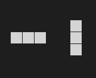
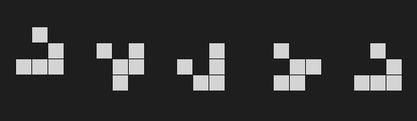
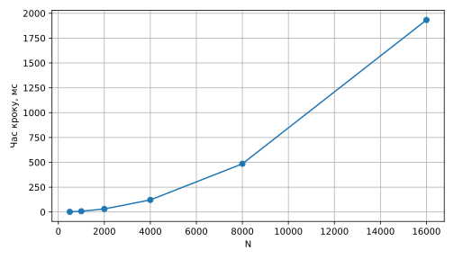
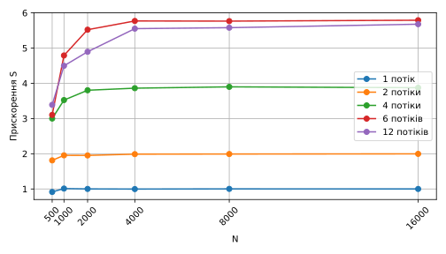
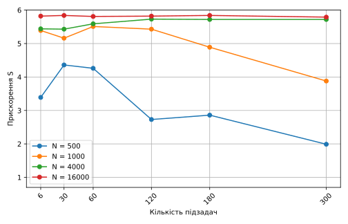

# Game of Life

Sequential and parallel implementations of Conway's Game of Life in Java. Parallel version uses `ExecutorService` with a fixed thread pool and horizontal row-strip partitioning. Speedup reaches **5.8x** at 6 threads on a 16000x16000 grid.

## Demo

[](https://raw.githubusercontent.com/SimonRoG/GameOfLife/raw/refs/heads/main/report/img/demo.mp4)

## Implementation

The grid is stored as a flat `boolean[]` array. Two buffers (`grid` and `next`) are swapped each step with no copying. Neighbor indices for each row (`up`, `mid`, `down`) are precomputed once outside the column loop to avoid modulo operations. The toroidal boundary wraps rows and columns without branching in the hot path.

The parallel version splits rows into `tasks` strips. Each strip is an independent `Callable` that reads from `grid` and writes to its own slice of `next` -- no shared writes, no locks. `invokeAll` acts as a barrier before the buffer swap.

Initialization uses `new Random(seed + r)` per row, so both versions produce the same starting grid regardless of thread count.

## Patterns

|           Block            |            Blinker             |            Glider            |
| :------------------------: | :----------------------------: | :--------------------------: |
|  |  |  |

Rules B3/S23 on a toroidal grid. Block is a still life, blinker is a period-2 oscillator, glider moves diagonally every 4 generations.

## Results

Measured on Intel Core i5-9400 (6 cores), OpenJDK 21.

### Time per step



|   N   | seq, ms | par 2, ms | par 4, ms | par 6, ms |
| :---: | ------: | --------: | --------: | --------: |
|  500  |    1.83 |      1.01 |      0.61 |      0.59 |
| 1000  |    7.33 |      3.75 |      2.08 |      1.53 |
| 2000  |   30.65 |     15.70 |      8.06 |      5.55 |
| 4000  |  121.76 |     61.24 |     31.53 |     21.10 |
| 8000  |  485.20 |    243.62 |    124.43 |     84.15 |
| 16000 | 1932.67 |    968.13 |    498.69 |    333.72 |

### Speedup



Speedup at 6 threads: 3.1x (N=500) to 5.8x (N=16000). Minimum requirement: 1.2x.

### Task-count sweep (6 threads)



At N>=2000 the step time is flat across 6-300 tasks. Overhead becomes visible only at N=500 with excessive splitting.

## Build

```bash
javac -d bin src/gol/*.java src/*.java
```

## Run

```bash
java -cp bin Main     # GUI
java -cp bin Test     # correctness tests
java -cp bin Bench    # benchmark
```

## Structure

```
src
├── Main.java               Swing GUI
├── Bench.java              benchmark: T(N) and task-count sweep
├── Test.java               correctness tests (glider, block, blinker; seq vs par)
└── gol
    ├── LifeEngine.java     abstract base: grid, computeRows, neighbors
    ├── GameOfLife.java     GUI canvas (50x100, draw with mouse)
    ├── GameOfLifePar.java  parallel implementation
    └── GameOfLifeSeq.java  sequential implementation
```
